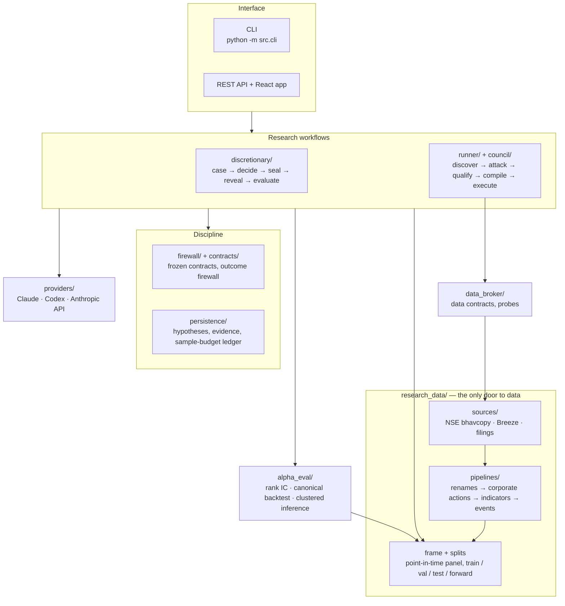

# brickbreak

An AI-driven trading research lab for NSE equities.

> **Can an AI, given rich point-in-time market context, pick unusually attractive
> opportunities better than strong, simple quantitative baselines?**

Not "does it make money" (luck can answer that), but whether *selection* improves
outcomes on the same candidates, against baselines that see the same cases. This is
a research instrument. Nothing here places orders. See [MISSION.md](MISSION.md).

## Architecture



Two ways to investigate a hypothesis, one shared ledger:

- **Discretionary replay** (`discretionary/`): an AI judges anonymised cases; its
  decisions are sealed *before* outcomes are revealed, then compared with baselines.
- **Signal path** (`runner/`, `council/`): an AI proposes a mechanism, a second
  provider attacks it, and only a frozen experiment contract may touch outcomes.

Both spend the same finite sample and are counted by the same multiplicity code.

## Rules that are enforced, not encouraged

- **One door to data.** Nothing but `research_data` opens a parquet file.
- **Partitions, never date ranges.** Whole quarters are assigned to train /
  validation / test with purged boundaries, plus a permanent forward lane.
- **The case cannot see the future.** Tested by building each case against a panel
  truncated at D and the full panel, and requiring identical bytes.
- **Anonymised by default.** Symbols and dates never reach the judge.
- **Baselines run at the AI's own take rate**, so selectivity isn't mistaken for skill.
- **The bar is in basis points, not t-statistics**, and a bar that can't fail is rejected.
- **Outcomes cost sample.** Only `reveal` / `execute` spend it, and a spent partition
  stays spent.

## Quick start

```bash
python3 -m venv .venv && .venv/bin/pip install -r requirements.txt
cp .env.example .env          # Breeze keys are only needed for intraday data
.venv/bin/python -m pytest tests/ -q
```

Market data is not included. Build it from NSE's free bhavcopy archive:

```bash
.venv/bin/python -m src.cli sync-nse --start 2022-01-01
.venv/bin/python -m src.cli sync-corp-actions && .venv/bin/python -m src.cli build-metrics
```

Run a replay (needs `ANTHROPIC_API_KEY`, or an installed `claude` / `codex` CLI):

```bash
.venv/bin/python -m src.cli opportunity "Stocks that resist a selloff may rebound harder" --hypothesis H041 -n 500
.venv/bin/python -m src.cli replay RPL_<id> --phase generate   # then build, decide, reveal, evaluate
```

`decide` and `reveal` are separate commands because they sit on opposite sides of
the seal. Inspect with `cases RPL_<id>` and `decisions RPL_<id> --full`.

## Where things are

| Path | What |
| --- | --- |
| `src/research_data/` | point-in-time data, splits, corporate actions, feature catalogue |
| `src/discretionary/` | cases, deciders, baselines, replay |
| `src/runner/`, `src/council/`, `src/contracts/`, `src/firewall/` | signal path and its gates |
| `src/alpha_eval/` | diagnostics, backtest, inference |
| `src/research/families/` | concrete research lines (a leaf; never imported by the lab) |
| `frontend/` | web UI |
| `HYPOTHESES.md`, `FINDINGS.md` | the research ledger and chronological evidence |
| `PLAN.md`, `AGENTS.md` | operating plan; conventions and every data trap found so far |

Most results to date are negative, and they are kept: a rejected hypothesis is a
result. Start with `HYPOTHESES.md`.

## License

MIT. See [LICENSE](LICENSE).
